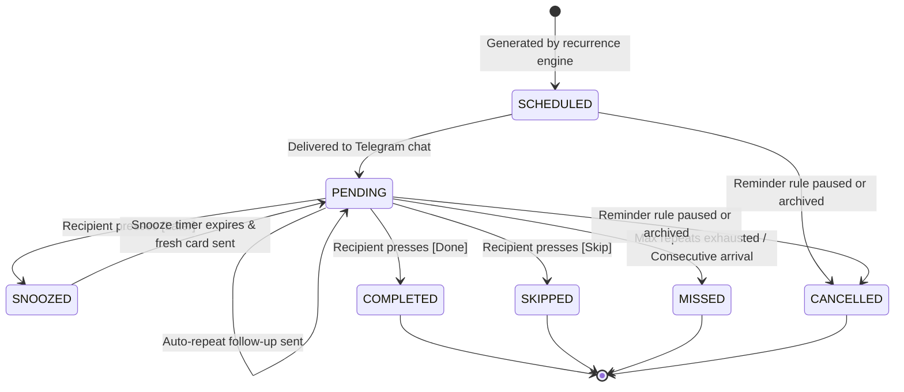

# HealthNotify

[](https://github.com/resonaura/healthnotify/actions/workflows/ci.yml)
[](https://nodejs.org/)
[](https://www.typescriptlang.org/)
[](https://nodejs.org/api/esm.html)
[](https://grammy.dev/)
[](https://www.sqlite.org/)
[](https://oxc.rs/)

A production-ready Telegram Health Reminder application built for families and caregivers. Designed to coordinate medical measurements (e.g. blood pressure monitoring at 06:00 and 20:00 daily for 14 days), medication regimens, exercise routines, and wellness check-ins with caregiver oversight.

---

## Overview

HealthNotify bridges patient compliance and caregiver peace of mind. Caregivers configure reminders through an interactive Telegram menu or creation wizard. Notifications can be delivered directly to the patient's private chat or broadcast to a shared family supergroup with explicit Markdown mentions.

Every notification is an interactive action card featuring **Done**, **Later**, and **Skip** buttons. The bot monitors responses, executes progressive snooze ladders, issues escalation notifications on ignore, and archives compliance logs in local SQLite storage.

---

## Key Features

- **Interactive Action Cards**: Telegram cards with inline buttons (`[✅ Done]`, `[🕒 Later]`, `[❌ Skip]`) that give instant feedback and deactivate once handled to prevent race conditions.
- **Dual-Channel Delivery**: Flexible delivery to private chats or family supergroups with explicit target mentions (`@username` or `[Name](tg://user?id=...)`).
- **Progressive Snooze Ladder**: Exponential snooze delays (`5m → 10m → 20m → 40m → 60m`) with in-place Telegram message updates reflecting the updated target time.
- **Unhandled Escalation**: Configurable auto-repeat follow-ups when reminders are ignored, terminating in a `MISSED` state once repeat limits are exhausted.
- **Consecutive Occurrence Policy**: When a new scheduled occurrence arrives (e.g. evening measurement), any pending or snoozed occurrences from earlier in the day are closed as `MISSED` with buttons deactivated.
- **Strict Authorization**: Action buttons can only be triggered by the targeted recipient or caregiver admins. Unauthorized clicks from other group members are rejected.
- **Resilient Crash Recovery**: On bot restart, an automated recovery reconciles missed events during downtime. Overdue occurrences within the catch-up window are delivered immediately; excessively late ones are marked `MISSED` without user spam.
- **Persistent Reply Keyboard UX**: Navigation system ported directly from `donnmemes` with persistent bottom keyboards, multi-level menus, and SQLite-persisted user state.
- **Interactive Creation Wizard**: Step-by-step reminder setup in Telegram covering title, description, schedule type, times of day, date boundaries, and target recipients.
- **Local SQLite with WAL Mode**: Zero external database server dependencies. Operates on a local SQLite database utilizing Write-Ahead Logging (`WAL`) and `busy_timeout` for concurrent read/write transactions.
- **Full Localization (i18n)**: Native Russian (`ru`) and English (`en`) support with pluralization and instant language switching.

---

## Reminder Lifecycle State Machine



---

## Quick Start

### Prerequisites

- **Node.js 24+**
- **npm** (comes with Node.js)
- A Telegram Bot Token from [@BotFather](https://t.me/BotFather)

### 1. Installation

```sh
git clone https://github.com/resonaura/healthnotify.git
cd healthnotify
npm install
```

### 2. Configuration Setup

Run the interactive setup wizard to configure your `.env` file, validate your Telegram Bot token against the Bot API, and run database migrations:

```sh
npm run setup
```

Or copy the example environment file manually:

```sh
cp .env.example .env
```

### 3. Run Database Migrations

```sh
npm run migrate
```

### 4. Start Application

**Development mode** (with TypeScript source execution via tsx):

```sh
npm run dev
```

**Production build and run**:

```sh
npm run build
npm run start
```

---

## Configuration

| Environment Variable            | Type         | Default                     | Description                                               |
| :------------------------------ | :----------- | :-------------------------- | :-------------------------------------------------------- |
| `TG_BOT_TOKEN`                  | string       | _required_                  | Telegram Bot API token from `@BotFather`                  |
| `TG_ADMIN_USER_IDS`             | string       | _required_                  | Comma-separated Telegram User IDs with admin access       |
| `DEFAULT_GROUP_CHAT_ID`         | number       | `null`                      | Default family supergroup chat ID (e.g. `-1004301185075`) |
| `DEFAULT_RECIPIENT_USER_ID`     | number       | `null`                      | Default target recipient User ID (e.g. `915156343`)       |
| `DATABASE_FILE`                 | string       | `.data/healthnotify.sqlite` | Path to the SQLite database file                          |
| `DEFAULT_TIMEZONE`              | string       | `Europe/Moscow`             | Default IANA timezone for reminder schedules              |
| `DEFAULT_LOCALE`                | `ru` \| `en` | `ru`                        | Default bot interface language                            |
| `SCHEDULER_INTERVAL_SECONDS`    | number       | `10`                        | Worker polling interval in seconds                        |
| `CATCH_UP_WINDOW_MINUTES`       | number       | `60`                        | Max downtime age for offline catch-up deliveries          |
| `DEFAULT_SNOOZE_INTERVALS`      | string       | `5,10,20,40,60`             | Progressive snooze delays in minutes                      |
| `DEFAULT_AUTO_REPEAT_INTERVALS` | string       | `5,10,20,40`                | Auto-repeat escalation intervals in minutes               |
| `MAX_SNOOZE_COUNT`              | number       | `5`                         | Maximum allowed snoozes before buttons lock               |
| `MAX_AUTO_REPEAT_COUNT`         | number       | `4`                         | Maximum unhandled repeats before marking `MISSED`         |

---

## Telegram Bot Interface

### Persistent Keyboard Menus

- **📋 Reminders (`RemindersMenu`)**: View active reminder rules, pause/resume reminders with one tap.
- **➕ New Reminder (`WizardMenu`)**: Interactive multi-step creation draft (title, times, schedule, period, target user).
- **👥 Recipients (`RecipientsMenu`)**: View registered patients, caregivers, and private message activation status.
- **💬 Chats (`ChatsMenu`)**: List registered group chats and primary family delivery destinations.
- **📊 History (`HistoryMenu`)**: Real-time compliance metrics (completion rate percentage, total occurrences, snoozes, missed).
- **⚙️ Settings (`SettingsMenu`)**: Inspect bot configuration, active timezones, escalation ladders, and switch interface language.

### Bot Commands

| Command      | Description                                          |
| :----------- | :--------------------------------------------------- |
| `/start`     | Open or re-initialize persistent navigation keyboard |
| `/menu`      | Return to root main menu                             |
| `/reminders` | Quick access to reminder rules                       |
| `/new`       | Start new reminder wizard draft                      |
| `/history`   | View adherence reports and compliance metrics        |
| `/chats`     | View linked delivery chat destinations               |
| `/settings`  | View bot settings                                    |
| `/cancel`    | Cancel active creation draft and discard changes     |
| `/language`  | Open language switcher                               |

---

## Architecture & Codebase Layout

```
healthnotify/
├── src/
│   ├── config/          # Zod schema and environment validation
│   ├── domain/          # Pure business logic (FSM, snooze, repeat, auth guards)
│   ├── scheduler/       # Cron recurrence engine, catch-up recovery, polling worker
│   ├── services/        # Reminder CRUD, occurrence processor, delivery & history
│   ├── persistence/     # TypeORM entities, DataSource, migrations, settings store
│   ├── bot/             # grammY bot setup, callback router, menu system & menus
│   ├── i18n/            # Typed bilingual localization dictionaries (ru / en)
│   ├── shared/          # Timezone utilities, masked logger, typed AppErrors
│   ├── app.ts           # Daemon orchestrator & graceful shutdown handlers
│   └── index.ts         # Production CLI entrypoint
├── scripts/
│   ├── setup.ts         # Interactive CLI setup wizard
│   └── migrate.ts       # Database migration CLI runner
├── tests/
│   ├── unit/            # Unit tests for domain, recurrence, snooze, FSM, services
│   ├── integration/     # Integration tests for persistence, recovery & edge cases
│   └── e2e/             # End-to-end bot interaction tests
├── docs/
│   └── ARCHITECTURE.md  # Detailed architecture documentation
├── .env.example
├── tsconfig.json
├── vitest.config.ts
└── package.json
```

---

## Verification & Quality Gates

HealthNotify enforces zero compromises on code quality, strict typing, and test verification:

```sh
# 1. Typecheck TypeScript across all files
npm run typecheck

# 2. Lint codebase with Oxlint
npm run lint

# 3. Verify formatting with Prettier
npm run format:check

# 4. Run full test suite with branch coverage thresholds
npm run test:coverage

# 5. Build native ESM production output
npm run build
```

---

## Production Deployment & PM2 Operations

HealthNotify includes a declarative PM2 JSON configuration (`ecosystem.config.json`) configured for high availability, auto-restart, memory capping, and graceful shutdown with zero CommonJS dependencies.

### 1. PM2 Process Management

```sh
# Start the bot under PM2 supervision
pm2 start ecosystem.config.json

# Persist active processes across server reboots
pm2 save

# Check running status and uptime
pm2 status healthnotify

# View real-time logs
pm2 logs healthnotify --lines 50

# Restart process gracefully
pm2 restart healthnotify

# Stop process
pm2 stop healthnotify
```

### 2. Updating in Production

```sh
git pull origin main
npm ci
npm run build
npm run migrate
pm2 restart healthnotify
```

---

## Security & Privacy Guarantees

- **Token Masking**: Sensitive tokens (Telegram bot credentials) are automatically scrubbed from application logs using regex redaction filters.
- **Privacy Mode**: In group chats, Telegram privacy mode ensures the bot only processes explicit mentions, commands, and callback queries.
- **GDPR Data Erasure**: Health measurement logs and adherence records can be purged via `HistoryService.deleteUserHealthData(userId)`.
- **Zero Cloud Footprint**: Data never leaves your host machine; the entire database resides in a local SQLite file.

---

## License

MIT © [resonaura](https://github.com/resonaura)
