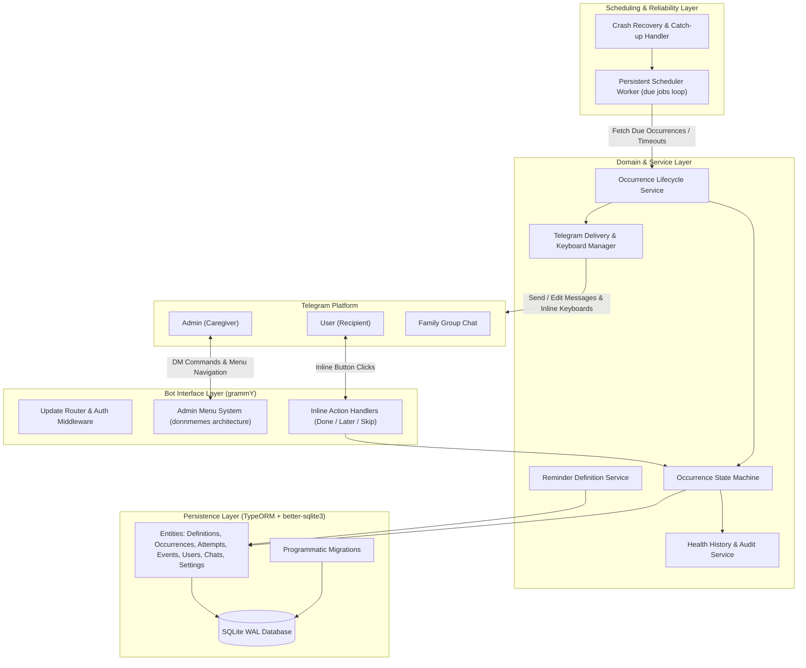
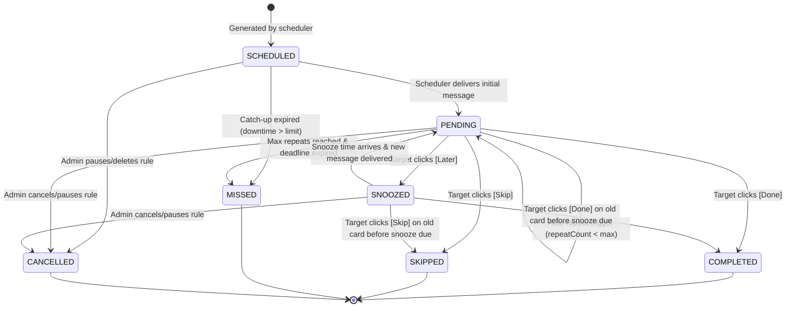

# HealthNotify — Architecture Specification

This document details the architectural design, domain model, state machine, persistence, scheduling mechanism, Telegram UI approach, and security policies for **HealthNotify** (Telegram Health Reminder Bot).

---

## 1. System Overview

HealthNotify is a personal and family health reminder management bot built with TypeScript, native Node.js ESM, grammY, TypeORM, and SQLite (`better-sqlite3`).

It enables administrators (e.g., family caregivers) to configure complex medication and measurement schedules (e.g., blood pressure checks twice daily for two weeks) and deliver actionable reminders directly to individuals via Telegram DM or designated family groups.

Reminders feature interactive inline buttons:

- `[✅ Done]`
- `[🕒 Later]`
- `[❌ Skip]`

Reminders implement an auto-repeat ignore policy, progressive snoozing, independent per-user occurrences, strict callback authorization, and persistence-backed job recovery across restarts.



---

## 2. Directory Structure

The project follows a clean modular architecture:

```text
healthnotify/
├── docs/
│   ├── ARCHITECTURE.md          # This document
│   └── adr/                     # Architectural Decision Records
├── scripts/
│   └── setup.ts                 # Interactive CLI onboarding (npm run setup)
├── src/
│   ├── index.ts                 # Application entry point & lifecycle bootstrapper
│   ├── app.ts                   # Application container & dependency wiring
│   ├── config/
│   │   ├── env.ts               # Zod environment schema & parser
│   │   └── env.test.ts          # Environment parsing tests
│   ├── bot/
│   │   ├── bot.ts               # grammY bot factory & middleware pipeline
│   │   ├── register.ts          # Command, message & callback query handlers
│   │   ├── menu-system.ts       # donnmemes menu framework (Menu, Button, MenuSystem)
│   │   ├── menus/               # Admin menus (MainMenu, RemindersMenu, Wizard, History, Settings)
│   │   └── keyboards/           # Actionable reminder inline keyboards & status builders
│   ├── domain/
│   │   ├── reminders/           # ReminderDefinition domain types & logic
│   │   ├── occurrences/         # ReminderOccurrence domain types & State Machine
│   │   ├── users/               # BotUser & role types (ADMIN, USER)
│   │   ├── history/             # History, audit events & measurement records
│   │   └── scheduler/           # Due-time calculation, recurrence & timezone handling
│   ├── services/
│   │   ├── reminder.service.ts  # Reminder CRUD & definition management
│   │   ├── occurrence.service.ts# Occurrence transitions & action coordinator
│   │   ├── delivery.service.ts  # Telegram message sending, keyboard editing & deactivation
│   │   ├── history.service.ts   # Completion stats, history queries & measurement logging
│   │   └── user.service.ts      # User onboarding & chat registration
│   ├── scheduler/
│   │   ├── worker.ts            # Persistent SQLite worker loop for due jobs
│   │   ├── recurrence.ts        # Recurrence generator (dates, times, timezones)
│   │   └── recovery.ts          # Startup crash recovery & overdue catch-up engine
│   ├── persistence/
│   │   ├── data-source.ts       # TypeORM DataSource with better-sqlite3 & WAL mode
│   │   ├── settings.store.ts    # Key-value SettingsStore (donnmemes pattern)
│   │   ├── entities/            # TypeORM entity definitions
│   │   │   ├── reminder-definition.entity.ts
│   │   │   ├── reminder-occurrence.entity.ts
│   │   │   ├── delivery-attempt.entity.ts
│   │   │   ├── reminder-event.entity.ts
│   │   │   ├── health-measurement.entity.ts
│   │   │   ├── bot-user.entity.ts
│   │   │   ├── registered-chat.entity.ts
│   │   │   └── app-setting.entity.ts
│   │   ├── migrations/          # Programmatic SQLite migrations
│   │   └── repositories/        # Typed query helpers & transaction wrappers
│   ├── i18n/
│   │   ├── index.ts             # Typed translations dictionary (ru, en) & interpolation
│   │   └── index.test.ts        # Localization unit tests
│   └── shared/
│       ├── errors.ts            # Domain & operational error classes
│       ├── logger.ts            # Structured logger with secret masking
│       └── time.ts              # Timezone, date & formatting utilities
├── tests/
│   ├── unit/                    # Unit tests (state machine, recurrence, i18n, env)
│   ├── integration/             # Integration tests (repositories, migrations, scheduler)
│   └── e2e/                     # End-to-end user scenario tests
├── .env.example
├── package.json
├── tsconfig.json
├── vitest.config.ts
├── oxlint.json
├── .prettierrc
└── README.md
```

---

## 3. Database Schema & Entities

All database timestamps are stored as **ISO 8601 UTC strings / datetime**.
SQLite operates with WAL mode enabled (`journal_mode = WAL`, `synchronous = NORMAL`, `foreign_keys = ON`, `busy_timeout = 5000`).

### 3.1 Entities

1. **`app_settings`**
   - `key` (varchar(64), PK): Setting key (e.g., `menu_nav_5456523288`, `user_lang_5456523288`).
   - `value` (text): Setting value.
   - `updatedAt` (datetime): Last modification.

2. **`bot_users`**
   - `id` (integer, PK): Telegram User ID (e.g., `5456523288`).
   - `username` (varchar(64), nullable): Telegram username without `@`.
   - `firstName` (text): User's first name.
   - `lastName` (text, nullable): User's last name.
   - `role` (varchar(16)): `'ADMIN'` or `'USER'`.
   - `dmActive` (boolean): `true` if user started the bot in DM (ready for private delivery).
   - `language` (varchar(8)): `'ru'` or `'en'`.
   - `dataConsent` (boolean): Whether personal health measurement storage is consented.
   - `createdAt`, `updatedAt` (datetime).

3. **`registered_chats`**
   - `id` (integer, PK): Telegram Chat ID (negative for groups/supergroups).
   - `title` (text): Group title.
   - `chatType` (varchar(32)): `'group'`, `'supergroup'`, `'channel'`.
   - `addedByUserId` (integer): Admin who connected the chat.
   - `isActive` (boolean): Whether delivery to this chat is allowed.
   - `createdAt`, `updatedAt` (datetime).

4. **`reminder_definitions`**
   - `id` (integer, PK, autoincrement): Definition ID.
   - `title` (text): Reminder title (e.g., "Measure Blood Pressure").
   - `description` (text, nullable): Instructions or notes.
   - `category` (varchar(32)): Category (`'measurement'`, `'medication'`, `'procedure'`, `'exercise'`, `'habit'`, `'custom'`).
   - `createdByUserId` (integer): Admin creator ID.
   - `targetUserIdsJson` (text): JSON array of Telegram User IDs assigned to this rule.
   - `destinationChatId` (integer): Target chat ID (DM chat ID or registered group chat ID).
   - `destinationType` (varchar(16)): `'dm'` or `'group'`.
   - `scheduleType` (varchar(32)): `'once'`, `'daily'`, `'weekdays'`, `'interval'`.
   - `timesOfDayJson` (text): JSON array of local time strings (`["06:00", "20:00"]`).
   - `daysOfWeekJson` (text, nullable): JSON array of day indices `[1, 2, 3, 4, 5]` (1=Mon, 7=Sun).
   - `timezone` (varchar(64)): IANA timezone name (e.g., `'Europe/Moscow'`).
   - `startDate` (varchar(10)): YYYY-MM-DD local start date.
   - `endDate` (varchar(10), nullable): YYYY-MM-DD local end date (inclusive, null = indefinite).
   - `snoozeIntervalsJson` (text): JSON array of progressive minutes, e.g. `[5, 10, 20, 40, 60]`.
   - `maxSnoozeCount` (integer, default 5): Maximum snooze clicks allowed.
   - `autoRepeatIntervalsJson` (text): JSON array of auto-repeat minutes, e.g. `[5, 10, 20, 40]`.
   - `maxAutoRepeatCount` (integer, default 4): Maximum auto-repeats on ignore.
   - `activeStatus` (varchar(16)): `'active'`, `'paused'`, `'archived'`.
   - `createdAt`, `updatedAt` (datetime).

5. **`reminder_occurrences`**
   - `id` (varchar(36), PK): UUID of this specific occurrence.
   - `reminderDefinitionId` (integer, FK -> reminder_definitions): Parent rule.
   - `targetUserId` (integer, FK -> bot_users): Person whose action is required.
   - `plannedAtUtc` (datetime): The original scheduled trigger timestamp.
   - `dueAtUtc` (datetime): The current active due timestamp (modified when snoozed or repeating).
   - `status` (varchar(16)): `'SCHEDULED'`, `'PENDING'`, `'SNOOZED'`, `'COMPLETED'`, `'SKIPPED'`, `'MISSED'`, `'CANCELLED'`.
   - `snoozeCount` (integer, default 0): Number of times snoozed.
   - `repeatCount` (integer, default 0): Number of auto-repeats sent.
   - `snoozedUntilUtc` (datetime, nullable): Due time for snooze delivery.
   - `lastDeliveredAtUtc` (datetime, nullable): Last time a message was sent for this occurrence.
   - `completedAtUtc` (datetime, nullable).
   - `skippedAtUtc` (datetime, nullable).
   - `missedAtUtc` (datetime, nullable).
   - `cancelledAtUtc` (datetime, nullable).
   - `activeMessageChatId` (integer, nullable): Chat ID of the active interactive message.
   - `activeMessageId` (integer, nullable): Telegram Message ID of the active interactive message.
   - `createdAt`, `updatedAt` (datetime).
   - **Indexes**:
     - `INDEX idx_occurrences_due_status (status, dueAtUtc)`
     - `UNIQUE INDEX uq_definition_target_planned (reminderDefinitionId, targetUserId, plannedAtUtc)`

6. **`delivery_attempts`**
   - `id` (integer, PK, autoincrement).
   - `occurrenceId` (varchar(36), FK -> reminder_occurrences).
   - `attemptType` (varchar(16)): `'initial'`, `'repeat'`, `'snooze'`.
   - `destinationChatId` (integer).
   - `status` (varchar(16)): `'success'`, `'failed'`.
   - `telegramMessageId` (integer, nullable).
   - `errorMessage` (text, nullable).
   - `attemptedAtUtc` (datetime).

7. **`reminder_events` (Audit & History Trail)**
   - `id` (integer, PK, autoincrement).
   - `occurrenceId` (varchar(36), FK -> reminder_occurrences).
   - `reminderDefinitionId` (integer).
   - `targetUserId` (integer).
   - `actorUserId` (integer): User who initiated the action, or `0` for system scheduler.
   - `eventType` (varchar(32)): `'scheduled'`, `'sent'`, `'repeated'`, `'snoozed'`, `'completed'`, `'skipped'`, `'missed'`, `'cancelled'`, `'paused'`, `'resumed'`, `'delivery_failed'`, `'unauthorized_click'`.
   - `payloadJson` (text, nullable): Context metadata.
   - `createdAtUtc` (datetime).

8. **`health_measurements`**
   - `id` (integer, PK, autoincrement).
   - `occurrenceId` (varchar(36), nullable, FK -> reminder_occurrences).
   - `targetUserId` (integer, FK -> bot_users).
   - `measurementType` (varchar(32)): `'blood_pressure'`, `'pulse'`, `'blood_sugar'`, `'weight'`, `'temperature'`, `'custom'`.
   - `valueJson` (text): Structured data (e.g. `{"systolic": 120, "diastolic": 80, "pulse": 70}`).
   - `note` (text, nullable).
   - `recordedAtUtc` (datetime).

---

## 4. Formal State Machine

Every `ReminderOccurrence` follows an explicit deterministic finite state machine (FSM).



### Invariants & Rules

1. **Terminal States**: `COMPLETED`, `SKIPPED`, `MISSED`, `CANCELLED` are terminal. No further state transitions are permitted once reached.
2. **Atomic Transitions**: Every transition executes within a database transaction with version/status guards (`UPDATE ... WHERE id = :id AND status = :expectedStatus`).
3. **Action Authorization**: Only `targetUserId` can execute `COMPLETED`, `SNOOZED`, or `SKIPPED`. If any other user clicks, the bot shows an alert popup via `answerCallbackQuery` and leaves the state unchanged.
4. **Snooze Progression**:
   - Snooze delays follow the definition progression (e.g., 5m -> 10m -> 20m -> 40m -> 60m).
   - When snoozed, the active message is updated: `"🕒 Snoozed until HH:mm"`.
   - On the snoozed card, **`[✅ Done]` and `[❌ Skip]` remain active**, while `[🕒 Later]` is disabled/removed. This allows the user to complete the action early without waiting for the snooze reminder to arrive.
   - When the snooze reminder fires, a new message is sent with full buttons, and the previous message's buttons are deactivated.
5. **Auto-Repeat Progression**:
   - If the user does not respond, repeats fire after defined intervals (e.g., 5m -> 10m -> 20m -> 40m).
   - On each repeat, previous message buttons are deactivated, and a fresh card is posted.
   - After `maxAutoRepeatCount`, if the occurrence remains unanswered past the occurrence deadline, it transitions to `MISSED`.
6. **Next Planned Occurrence Policy**:
   - If a new scheduled occurrence of the same rule arrives (e.g., evening 20:00 occurrence arrives while morning 06:00 occurrence was unanswered), the old occurrence is closed as `MISSED`, its active buttons are deactivated, and the new occurrence begins cleanly. This prevents lingering duplicate notifications.

---

## 5. Scheduler & Reliability Engine

### 5.1 Architecture

1. **Source of Truth**: SQLite database.
2. **Worker Loop**: Runs every 10 seconds.
   - Queries due occurrences:
     ```sql
     SELECT id, status, dueAtUtc FROM reminder_occurrences
     WHERE status IN ('SCHEDULED', 'PENDING', 'SNOOZED')
       AND dueAtUtc <= :nowUtc
     ORDER BY dueAtUtc ASC
     LIMIT 50;
     ```
3. **Atomic Claim**:
   - The worker claims a job atomically:
     ```sql
     UPDATE reminder_occurrences
     SET dueAtUtc = :nextRetryUtc
     WHERE id = :id AND status = :expectedStatus;
     ```
   - This prevents race conditions if multiple workers or restarts happen concurrently.
4. **Recurrence Generator**:
   - Calculates occurrences ahead of time (e.g. rolling 7-14 days window) based on rule timezone, schedule type, and start/end dates.
   - Uses unique constraint `(reminderDefinitionId, targetUserId, plannedAtUtc)` to prevent duplicates.
5. **Catch-Up & Crash Recovery**:
   - If the bot was offline, upon restart `RecoveryHandler` evaluates overdue occurrences:
     - If overdue $\le$ `CATCH_UP_WINDOW_MINUTES` (default 60 minutes): deliver immediately, keeping original `plannedAtUtc`.
     - If overdue $>$ `CATCH_UP_WINDOW_MINUTES`: mark as `MISSED` with an audit event (`catch_up_expired`), preventing notification storms after extended downtime.

---

## 6. Authorization & Security Model

1. **Two Roles**:
   - **`ADMIN`**:
     - Configured by permanent Telegram User IDs in `.env` (`TG_ADMIN_USER_IDS`).
     - Can access full DM admin menu, create/edit/pause/delete reminders, view system status and delivery health.
   - **`USER`**:
     - Recipient of health reminders.
     - Can interact only with their own occurrences via inline buttons.
     - Can view their own history and register personal language/timezone preferences.
2. **Callback Authorization Guard**:
   - Every inline button callback carries `act:<action>:<occurrenceId>`.
   - The handler loads the occurrence from SQLite and checks:
     `ctx.from.id === occurrence.targetUserId`.
   - If mismatch:
     `await ctx.answerCallbackQuery({ text: t(lang, "error_not_your_reminder"), show_alert: true })`.
     Logs security audit event (`unauthorized_click`).
     Zero message sent to chat. No state modified.
3. **Group Privacy**:
   - In group chats, reminders mention the specific recipient (using `@username` or `tg://user?id=123456789`).
   - Detailed private health metrics (blood pressure measurements, systolic/diastolic values) are **never** posted to group chats.
   - Group messages only display general procedure status: `"🩺 Reminder for User: Time to measure blood pressure"` and status updates (`"✅ Done by User"`).

---

## 7. Telegram UI & Menu System Architecture (1:1 port from `donnmemes`)

The admin interface in DM replicates the proven architecture from `donnmemes`:

1. **`MenuSystem`**:
   - Persistent reply keyboard: `{ resize_keyboard: true, is_persistent: true }`.
   - Navigation state stored in `SettingsStore` (`menu_nav_<userId>`).
   - `handleButton(ctx, text)` matches button text and dispatches typed `MenuAction`.
   - Survives bot restarts; resumes user at their last menu screen.
2. **Menu Tree**:
   - `MainMenu`:
     - 📋 Reminders (`RemindersMenu`)
     - ➕ Create Reminder (`WizardMenu`)
     - 👥 Recipients (`RecipientsMenu`)
     - 💬 Connected Chats (`ChatsMenu`)
     - 📊 History & Analytics (`HistoryMenu`)
     - ⚙️ Settings (`SettingsMenu`)
3. **Creation Wizard**:
   - Step-by-step state machine with persistent draft in `SettingsStore`:
     1. Title
     2. Description (optional)
     3. Category (Measurement, Medication, Procedure, Exercise, Custom)
     4. Recipient(s) selection
     5. Destination (DM or registered group)
     6. Timezone selection
     7. Schedule type & times of day (e.g., 06:00 and 20:00)
     8. Duration (e.g., 14 days or indefinite)
     9. Snooze & repeat intervals policy
     10. Preview & Confirmation
   - Supports `[⬅️ Back]`, `[✖️ Cancel]`, and input validation on each step.

---

## 8. Health History & Measurements

1. **History Tracking**:
   - For every occurrence: scheduled time, delivery time, response time, action taken (done, snoozed, skipped, missed), repeat count, snooze count.
2. **Metrics & Completion Rate**:
   - Completion rate = $\frac{\text{Completed}}{\text{Completed} + \text{Skipped} + \text{Missed}} \times 100\%$.
   - Denominator strictly excludes upcoming or in-flight occurrences (`SCHEDULED`, `PENDING`, `SNOOZED`).
3. **Optional Structured Measurements**:
   - For blood pressure reminders: when recipient clicks `[Done]`, the bot offers an optional prompt in DM:
     `"Send your reading (e.g. 120/80 72) or skip"`.
   - Validated via Zod (`systolic: 50-250`, `diastolic: 30-150`, `pulse: 30-220`).
   - Stored in `health_measurements` table with consent check.
   - Available for export or review in private DM view.

---

## 9. Internationalization (i18n)

Follows the type-safe dictionary approach proven in `donnmemes`:

- Full translations for `ru` (Russian) and `en` (English).
- Fallback to Russian as primary user language.
- Typed interpolation helper `t(lang, key, params)` preventing missing keys at compile time.
- Correct Russian pluralization (`1 пост`, `2 поста`, `5 постов`, `1 день`, `2 дня`, `5 дней`).
- No flag emojis on language toggle buttons.

---

## 10. Architectural Decision Records (ADRs)

### ADR-1: Native Node.js ESM + TypeScript NodeNext

- **Decision**: Use `"type": "module"` in `package.json`, TypeScript with `module: NodeNext` and `moduleResolution: NodeNext`.
- **Rationale**: Clean, modern, future-proof, strictly matching project requirements without CJS shims.

### ADR-2: Direct Architectural Port of `donnmemes` Menu System

- **Decision**: Port `MenuSystem`, `Menu`, `Button`, and `SettingsStore` pattern from `/Users/resonaura/donnmemes`.
- **Rationale**: Guarantees identical navigation UX, reliable message updates, and zero learning curve for the user.

### ADR-3: Persistent SQLite-backed Scheduler without External Broker

- **Decision**: Implement recurring scheduler worker using SQLite transactions with WAL mode.
- **Rationale**: Minimal complexity, zero external server dependencies (Redis/RabbitMQ not needed for family scale), crash-resilient across restarts.

### ADR-4: Type-Safe Dictionary i18n

- **Decision**: Use strongly-typed TypeScript translation dictionaries over runtime YAML/JSON file loaders.
- **Rationale**: Compile-time safety for all translation keys, zero runtime missing file errors in ESM, instant performance.

### ADR-5: Independent Occurrences per Target User

- **Decision**: When a reminder definition is assigned to multiple recipients, generate a separate `ReminderOccurrence` record for each user.
- **Rationale**: Prevents one user from completing another user's health action; allows independent snoozing, statistics, and audit trail.
